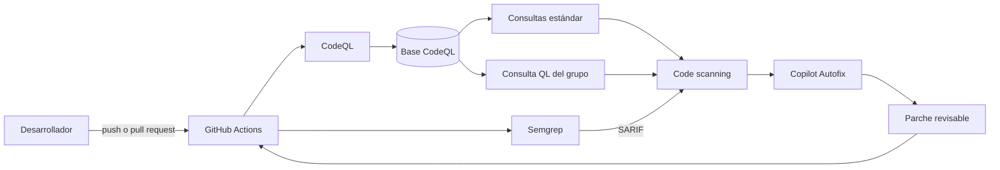

# Arquitectura del laboratorio

El laboratorio muestra cómo dos analizadores estáticos procesan el mismo cambio
antes de que llegue a producción. La aplicación contiene vulnerabilidades
intencionales y solo debe ejecutarse en un ambiente local autorizado.

## Flujo estudiado

1. `category` entra por `req.query`.
2. La versión vulnerable concatena el dato en una instrucción SQL.
3. CodeQL modela el recorrido desde la fuente HTTP hasta `pool.query`.
4. Semgrep aplica reglas sintácticas locales sobre el mismo archivo.
5. GitHub presenta ambos resultados en Code scanning.
6. Copilot Autofix propone una modificación para una alerta estándar compatible.
7. El grupo revisa el parche, ejecuta las pruebas y repite los análisis.

La consulta `DangerousEval.ql` es una demostración separada. Su objetivo es
enseñar la estructura de QL con un caso pequeño; la demostración de Autofix debe
usar una alerta estándar compatible, no la alerta personalizada.
